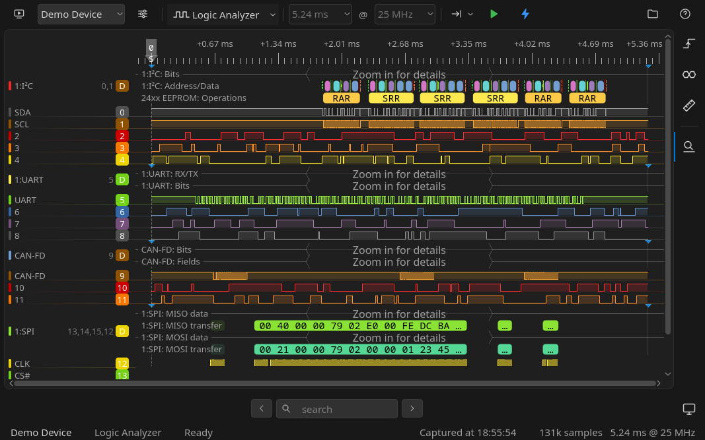

# DSView — modern UI

A redesign of the [DSView](https://github.com/DreamSourceLab/DSView) user
interface, the open-source software for DreamSourceLab logic analyzers and
oscilloscopes. The instruments, drivers and protocol decoders work as before;
what changes is how the app looks and feels: a clean, flat, editor-style
layout with dark and light themes.



> This is an unofficial fork, not affiliated with or supported by
> DreamSourceLab. Upstream development has slowed down, so this fork does not
> hold back on larger changes.

## What's different

- **Dark and light themes**, flat and consistent across every window.
- **One top bar** for device, mode and capture settings; panels open from
  an activity bar on the right; a status bar shows what was captured.
- **Easier-to-read waveforms**: a names column, values under the mouse,
  monospace numbers, measurements shown as cards.
- **Dialogs that fit their content**, with consistent buttons and a
  visible keyboard focus ring.
- **New app icon**, no start-up prompt, and a Flatpak package.

Design rules for contributors are in
[DSView/themes/STYLE_GUIDE.md](DSView/themes/STYLE_GUIDE.md); the theme files
and live editing are described in
[DSView/themes/README.md](DSView/themes/README.md).

## Building

Dependencies and per-distro package lists are in [INSTALL](INSTALL). In short
(Qt 6 recommended):

```bash
mkdir build && cd build
cmake ..        # with CMake 4: cmake -DCMAKE_POLICY_VERSION_MINIMUM=3.5 ..
make -j$(nproc)
sudo make install
```

Useful flags for working on the UI:

```bash
./build.dir/DSView --gallery                # every control in the current theme
DSVIEW_THEME_DIR=DSView/themes ./build.dir/DSView   # reload the theme on save
```

### Flatpak

```bash
just deploy     # build, bundle and install (system; `just scope=user deploy`)
just run
```

Setup, the host udev rule for USB access and building inside a distrobox are
covered in [flatpak/README.md](flatpak/README.md).

---

## About DSView (original README)

DSView is a GUI program for supporting various instruments from
[DreamSourceLab](http://www.dreamsourcelab.com), including logic analyzers,
oscilloscopes, etc. DSView is based on the [sigrok project](https://sigrok.org).

The sigrok project aims at creating a portable, cross-platform,
Free/Libre/Open-Source signal analysis software suite that supports various
device types (such as logic analyzers, oscilloscopes, multimeters, and more).

### Status

The DSView software is in a usable state and has official tarball releases.
However, it is still a work in progress. Some basic functionality is available
and working, but other things are always on the TODO list.

### Useful links

- [dreamsourcelab.com](https://www.dreamsourcelab.com)
- [kickstarter.com](https://www.kickstarter.com/projects/dreamsourcelab/dslogic-multifunction-instruments-for-everyone)
- [sigrok.org](https://sigrok.org)

### Copyright and license

DSView software is licensed under the terms of the GNU General Public License
(GPL), version 3 or later.

While some individual source code files are licensed under the GPLv2+, and
some files are licensed under the GPLv3+, this doesn't change the fact that
the program as a whole is licensed under the terms of the GPLv3+ (e.g. also
due to the fact that it links against GPLv3+ libraries).

Please see the individual source files for the full list of copyright holders.
